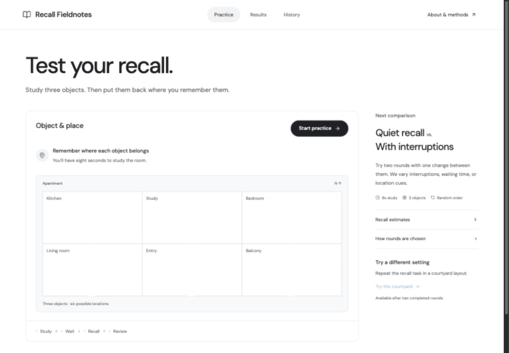
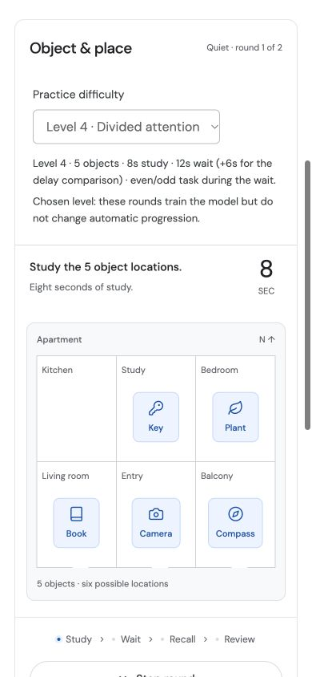

# Recall Fieldnotes

Submission source for the Future Health Digital Innovation Challenge.

**Live prototype: [recall.laphynya.my](https://recall.laphynya.my)**

Recall Fieldnotes is a browser-based object-location recall practice and task-research prototype. Participants study three to five objects, wait briefly, and return each object to its room. Repeated comparisons vary interruptions, waiting time, or location cues.



## Reviewer walkthrough

1. Open the live prototype. Core practice works without signing in.
2. Select **Start practice**, study the objects for eight seconds, wait, and answer the location prompts.
3. Complete the comparison's second round, then open **Results** and **History**.
4. Inspect recall estimates and model assumptions. Completed guest rounds save in the same browser.

Optional Google sign-in enables private cloud history on the live deployment. Guest results are copied to an account only after an explicit action. Research permission is separate and off by default. Private administration and participant datasets are not part of public reviewer access.

## Run locally

Use Node.js 22.16+ or Node.js 24 and npm:

```sh
npm ci
npm run dev
```

The core app works without API keys or an external dataset. Cloud sign-in is unavailable until you configure your own backend. Python is required only for the separate training pipeline and Python tests.

```sh
python3 -m venv .venv
.venv/bin/pip install -r backend/requirements.txt -r ml/requirements.txt
npm test
.venv/bin/python -m unittest discover -s tests -p 'test_*.py'
npm run format:check
npm run build
```

Cloudflare-specific local checks:

```sh
npm run db:local
npm run dev:cloudflare
npm run check:cloudflare
```

## Models and evidence

- **Online Bayesian learner:** estimates per-object recall separately for each condition and difficulty using equal Beta(2,2) priors. Valid answers update its parameters. The scheduler chooses useful comparisons subject to condition coverage.
- **Prediction evaluation:** records forecasts before answers and compares them with a pooled baseline. Restored/imported forecasts are reconstructed rather than counted as originally recorded live predictions.
- **Offline supervised pipeline:** fits regularized logistic regression to permission-recorded task exports. Its target is recalling at least two thirds of the objects, rounded up. Features include prescribed task settings and preceding valid trials; current answers are excluded. Training and evaluation separate participants.
- **Fixed research hypotheses:** a separate illustrative comparison of equal performance, interruption effects, delay effects and cue effects. It uses level-one observations only. Its assumed effects are not trained clinical estimates.

The repository supplies the pipeline and tests, not a participant dataset or fitted participant model. Synthetic fixtures verify implementation only. They do not establish predictive accuracy, clinical effectiveness, or demographic fairness. Model promotion requires explicit review. See [training details](ml/README.md).

These are task-performance estimates. The app does not infer Alzheimer's risk, cognitive age, brain-network function, diagnosis, or treatment benefit. Within-trial dependence, practice, adaptive sampling, device differences and fatigue limit interpretation. An alternate courtyard layout does not establish real-world transfer.

## Architecture

| Layer | Implementation |
| --- | --- |
| Interface and task | React + Vite |
| Device history | IndexedDB |
| Optional account identity | Google OpenID Connect |
| Optional API and storage | Cloudflare Pages Functions + D1 |
| Research administration | Verified Cloudflare Access identity and admin allowlist |
| Retention | Scheduled Worker, 365-day cloud-round expiry |
| Training | Offline scikit-learn, portable JSON weights |

Server requests enforce ownership, CSRF protection, canonical scoring, idempotent writes and conflict detection. Research exports include only currently permissioned, unexpired sessions. Responses remain client-reported rather than independently verified observations.

## Submission isolation

This is an independently initialized source snapshot. It is **not** the private production repository, a fork carrying private history, or a deployment source for the live app. It contains no production credentials, account-specific Cloudflare configuration, participant exports, database snapshots, original Git history or ChatGPT Sites project metadata.

Included Wrangler files use **local-only** database IDs and submission-specific names. The GitHub workflow runs checks only. It does not deploy. To run your own cloud backend, follow [independent deployment setup](docs/PRODUCTION.md) with your own resources and credentials.

## Source map

- `src/`: task interface, browser storage and statistical models.
- `server/`, `functions/`, `migrations/`, `workers/`: optional backend, authorization, schema and cleanup.
- `ml/`: dataset preparation, training and evaluation.
- `tests/`: task, model, storage and security checks using isolated fixtures.
- `backend/`, `src/LegacyApp.jsx`, `src/engine.js`, `src/style.css`: archived synthetic network sandbox and its tests, not loaded by the current app.

## Attribution and terms

Third-party software remains governed by its own licences. React, React DOM, Vite and jose declare MIT licences, Lucide declares ISC, and scikit-learn uses BSD-3-Clause. Preserve applicable notices when redistributing. See [third-party materials](THIRD_PARTY_NOTICES.md).

Stanford's connectome research is background reading in Methods. This project does not reproduce its published model, bundle Stanford media or OASIS participant records, or imply university endorsement. Recall Fieldnotes is a working product name without formal trademark clearance.

This public repository supports challenge review. No open-source licence is granted here for project-specific code. Public visibility does not by itself grant additional reuse rights. Any applicable competition submission terms remain separate.

## Progressive difficulty

This protocol is included in the source snapshot. Updating the live prototype is a separate deployment step.

Four integrated levels increase load from three to five objects, extend retention and add an even/odd retention task at level four. Automatic progression follows completed-pair performance, with every fourth automatic comparison returning to a level-one reference. Manual selection lets judges try any level immediately; these trials train the level-specific learner without changing automatic progression. Results filter by difficulty. Old three-object sessions still restore; prior fitted artifacts require retraining with v2 features. See [protocol and reviewer walkthrough](docs/DIFFICULTY.md).


